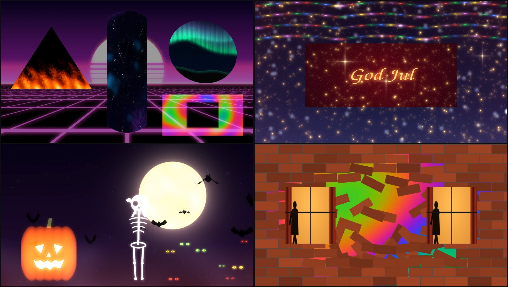
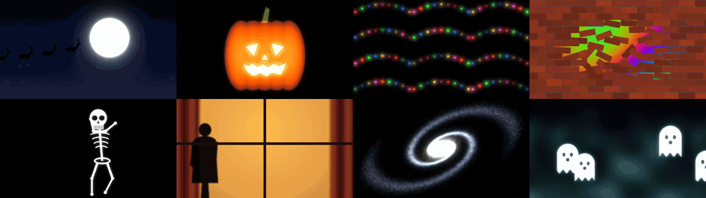
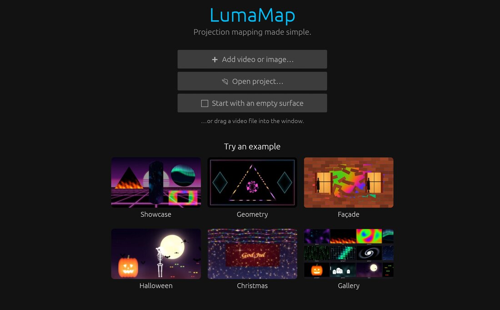
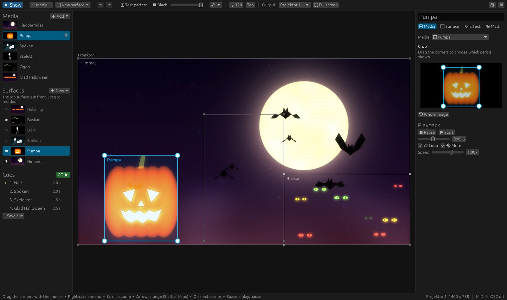
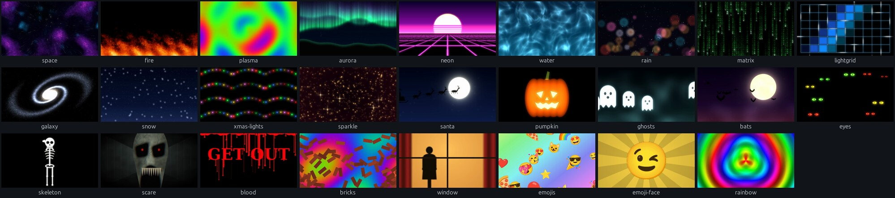
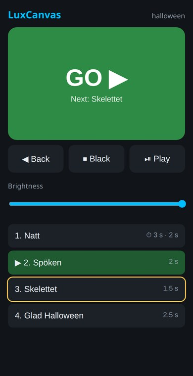

# LuxCanvas – projection mapping software for Linux

**Free and open-source projection mapping (video mapping) for Linux.** Put
video on any surface – a wall, a pillar, a ball, a whole house – by dragging
its corners until it fits. Built in Rust with wgpu and GStreamer, for artists,
VJs, theatres, museums, shops and anyone decorating their house for
Christmas or Halloween.

[](LICENSE)
[](#install)
[](https://www.rust-lang.org/)
[](#install)

The goal: *map a video onto a wall in two minutes without reading a manual.*
A free alternative to MadMapper, HeavyM and the mapping part of Resolume
Arena – none of which run on Linux – in the spirit of
[MapMap](https://mapmap.info) (simple and visual) and
[Splash](https://sat-mtl.gitlab.io/documentation/splash/) (several projectors
with edge blending).



<sub>The example projects in `examples/` – `showcase`, `christmas`, `halloween` and `facade` – exactly as the projector shows them.</sub>

> **Status:** young but complete. Used for experiments and small shows;
> developed and tested on Linux Mint (Ubuntu 24.04 base) with one projector
> at a time. Reports from bigger setups are very welcome.

## Features

**Mapping**
- **What you see is what the projector shows** – the editor preview and the
  projector windows render the same image, live.
- **Surfaces:** quad (perspective-correct, no diagonal seam), triangle,
  ellipse and curved mesh for arches – and **3D objects**: a sphere (ball),
  a cylinder (round pillar, barrel) and a cone (Christmas tree), where the
  image wraps around the object instead of looking stretched – plus **lines
  of light** you draw with the mouse.
- **Snapping:** corners snap to other surfaces and to the image edge, so
  neighbouring surfaces meet without gaps.
- **Select several surfaces** and move them together – handy for a façade
  full of windows.
- **Masks** with soft edges – cut out a window or a door. Masks stay put on
  the wall when you adjust the surface.
- **Align with a webcam:** the projector shows a few dots, the camera finds
  them, and you click the wall's corners in the camera picture.
- **Several projectors** with keystone, **edge blending** and black-level
  compensation where they overlap.

**Content**
- Video files, images, webcams, network streams (RTSP, SRT, UDP, HTTP),
  solid colours and **live patterns** drawn on the GPU – no video needed.
- **21 ready-made loops** to use freely – space, fire, aurora, Christmas,
  Halloween, a collapsing brick façade and more (see [Examples](#examples)).
- **Effects on any surface:** edge lights that follow the surface's shape
  (edge glow, chasing lights, neon frame, light sweep), kaleidoscope, tiles,
  scroll, rotate, pulse, colour cycle, strobe, blur, invert – in time with a
  tempo you tap in. Edge lights turn plain shapes into a geometric show with
  no video at all.
- **Sound-reactive:** effects can follow the bass from a microphone or from
  what the computer plays; the tempo is picked up from the music.
- Crop, blend modes (normal, add, multiply, screen) and colour correction
  per surface.

**Show control**
- **Cues** with fades: store which surfaces are visible, how bright and with
  which media, and step through them with **Enter** – or let them run by
  themselves after a set time, in a loop.
- **Live clips:** a grid of every clip – click or press 1–9 to switch a
  surface's media, on the next beat if you like.
- **Phone remote:** scan a QR code and get GO, Black, brightness and the cue
  list on your phone – no app needed.
- **Motion:** a webcam sees people move – effects follow the motion, and a
  cue can start when someone walks past.
- **Schedule** for installations: on at 16:00, black at 23:00, every day.
- **OSC** (TouchOSC, QLab, …), **MIDI** controllers with learn, and **DMX
  lights over Art-Net** that fade with the cues – a lamp can even take its
  colour from a video, and **LED pixel strips** take their colours from the
  projector image where they lie.
- **Undo everything**, autosave every 30 s and crash recovery.
- `--play` starts a show in fullscreen, e.g. from autostart.
- English and Swedish user interface.



## How it compares

| | LuxCanvas | MadMapper | HeavyM | Resolume Arena |
|---|---|---|---|---|
| Runs on Linux | ✅ | – (Windows, macOS) | – (Windows, macOS) | – (Windows, macOS) |
| Free and open source | ✅ AGPL-3.0 | – (paid) | – (freemium) | – (paid) |

Everything LuxCanvas does is listed under [Features](#features): surfaces from
quads to balls and cones, several projectors with edge blending, cues with a
timeline and schedule, phone remote, OSC, MIDI, DMX lights and LED pixel
mapping over Art-Net, audio- and motion-reactive effects.

## Install

Download from the [latest release](https://github.com/dio99/luxcanvas/releases/latest):

- **AppImage** – runs on most distributions, nothing to install:
  ```bash
  chmod +x LuxCanvas-*-x86_64.AppImage
  ./LuxCanvas-*-x86_64.AppImage
  ```
- **.deb** – Ubuntu 24.04+, Linux Mint 22+, Debian 13+: double-click it, or
  ```bash
  sudo apt install ./luxcanvas_*_amd64.deb
  ```
- **.rpm** – Fedora 40+:
  ```bash
  sudo dnf install ./luxcanvas-*.x86_64.rpm
  ```
- **Flatpak** – any distribution with Flatpak; the runtime comes from Flathub
  automatically:
  ```bash
  flatpak install --user LuxCanvas-*-x86_64.flatpak
  flatpak run io.github.dio99.LuxCanvas
  ```

The .deb and .rpm use the system's GStreamer and install the examples in
`/usr/share/luxcanvas`. Older distributions: use the AppImage.

To build all four for a release: `packaging/build-release.sh` (files end up
in `target/release-files/`).

### Building the AppImage

Build a self-contained AppImage (GStreamer included) yourself:

```bash
packaging/appimage/build.sh
./target/appimage/LuxCanvas-x86_64.AppImage
```

### Building the Flatpak

```bash
flatpak install --user flathub org.flatpak.Builder org.freedesktop.Sdk//26.08 \
    org.freedesktop.Sdk.Extension.rust-stable//26.08
flatpak run org.flatpak.Builder --user --install --force-clean \
    target/flatpak packaging/flatpak/io.github.dio99.LuxCanvas.yml
flatpak run io.github.dio99.LuxCanvas
```

After changing dependencies, regenerate the offline crate list with
`python3 packaging/flatpak/cargo-sources.py`. Rebuild the Flatpak after code
changes – it is built from the repository and does not update itself.
To make a single-file `.flatpak` for a release:

```bash
flatpak run org.flatpak.Builder --user --force-clean --repo=target/flatpak-repo \
    target/flatpak packaging/flatpak/io.github.dio99.LuxCanvas.yml
flatpak build-bundle --runtime-repo=https://dl.flathub.org/repo/flathub.flatpakrepo \
    target/flatpak-repo LuxCanvas-x86_64.flatpak io.github.dio99.LuxCanvas
```

The Flatpak can read media in your Videos, Pictures, Documents, Downloads
and Desktop folders and on USB drives. If your projects live somewhere else,
give it access once:

```bash
flatpak override --user --filesystem=home io.github.dio99.LuxCanvas
```

### From source

**1. System libraries** (Debian, Ubuntu, Linux Mint):

```bash
sudo apt install libgstreamer1.0-dev libgstreamer-plugins-base1.0-dev \
    gstreamer1.0-plugins-good gstreamer1.0-plugins-bad gstreamer1.0-libav \
    gstreamer1.0-vaapi libxkbcommon-dev libwayland-dev
```

**2. Rust** 1.95 or newer, from [rustup.rs](https://rustup.rs).

**3. Build and run:**

```bash
git clone https://github.com/dio99/luxcanvas.git
cd luxcanvas
cargo run --release
```

The binary ends up in `target/release/luxcanvas`.

## Getting started

LuxCanvas opens with a welcome screen: add a video, open a project, or click
one of the examples to see how a finished show is built.



1. Drag a video or image into the window. It appears on a new surface.
2. Drag the surface's four corners until they fit the wall.
3. Drag the projector window onto the projector and press **F** for fullscreen.
4. Press **▶ Show** (or **Tab**) to hide the handles.

Use **⊞ Test pattern** while aligning. Save with **Ctrl+S**: projects are
`.lmap` files with media paths relative to the project file. Recent projects
are on the welcome screen and under ☰ → **Recent**.



**The editor** has three parts:

- **Left – media, surfaces and cues.** Every row has a live thumbnail.
  **➕ Add** adds a video, pattern, colour, test pattern, camera or stream.
  Drag media onto a surface (in the list or in the preview) to show it there.
  Drag surfaces up and down to change which one is in front; 👁 hides one.
  Cues show their fade time, ▶ marks the running cue and › the next one.
- **Middle – the projector preview.** Drag corners or whole surfaces. A
  corner snaps to the corners and edges of other surfaces and to the edge of
  the image (a yellow ring shows it); hold **Ctrl** to drag freely.
  **Shift-click** surfaces (in the preview or the list) or **Shift-drag** a
  box around them to select several; drag one of them, or use the arrow
  keys, and they all move together. The right side then also offers show,
  hide, lock, give them all the same media, and delete.
  **Right-click** a surface for a menu (media, shape, straighten, fill,
  front/back, duplicate, delete). **Scroll** to zoom in on a corner, drag
  with the **middle button** to pan, and click the 🔍 button to zoom out.
- **Right – the selected surface**, in four tabs: **Media** (which media,
  the crop and playback), **Surface** (shape, blending, opacity), **Effect**
  (effect and colour) and **Mask**. A dot on a tab means something is
  switched on there. With no surface selected, the right side shows the
  projector output instead: keystone, edge blending and **📷 Align with
  camera…**.

**Aligning with a webcam:** point the camera at the wall, click **📷 Align
with camera…** and **Start**. The projector shows nine dots one at a time
(about ten seconds); then click the wall's four corners in the camera picture
and the surface lands exactly there. Works best in a darkish room.

**Drawing lines of light:** **⬜ New surface → ✏ Draw line** (or press **D**)
and drag with the mouse in the preview. Each stroke becomes a smooth line of
light – a glowing neon tube in the selected media's colours (a rainbow if
nothing is selected). Set the width before you draw; afterwards the line's
points can be dragged like any corner, and its width and effect changed in
the **Surface** and **Effect** tabs. **Esc** finishes.

**Balls, pillars and cones:** pick **Sphere**, **Cylinder** or **Cone** as
the shape (under **⬜ New surface** or in the **Surface** tab). Drag the four
corners to the edges of the ball or pillar (for a cone: the tip and the two
bottom corners). The image then wraps around the object, so it is not
stretched at the sides. The effect **Scroll** makes the object seem to spin.

**Moving a show to another computer:** ☰ → **Collect project…** copies the
project and every media file it uses into one folder.

**Starting a show automatically**, e.g. at boot in an installation:

```bash
luxcanvas --play show.lmap
```

## Examples



`examples/media/` holds seamless 12-second loops (1280×720) that you are free
to use in your own shows:

| Video | |
|---|---|
| `space.mp4` | Flying through a star field with coloured nebulae |
| `fire.mp4` | Flames licking upwards |
| `plasma.mp4` | Slowly flowing rainbow colours |
| `aurora.mp4` | Northern lights over mountains |
| `neon.mp4` | Synthwave grid floor under a striped sun |
| `water.mp4` | Light rippling on the bottom of a pool, with drops landing |
| `rain.mp4` | Raindrops on a window in front of blurred city lights |
| `matrix.mp4` | Falling green "Matrix" characters |
| `lightgrid.mp4` | Glowing window frames with light pulses – made for building façades |
| `galaxy.mp4` | A rotating spiral galaxy |
| **Christmas** | |
| `snow.mp4` | Snow falling in three layers |
| `xmas-lights.mp4` | Strings of coloured lights that chase and twinkle – along the eaves |
| `sparkle.mp4` | Falling gold glitter and twinkling stars |
| `santa.mp4` | Santa's sleigh and reindeer flying past the moon |
| **Halloween** | |
| `pumpkin.mp4` | A carved pumpkin with a flickering candle inside |
| `ghosts.mp4` | Ghosts floating through fog |
| `bats.mp4` | Bats flapping past the full moon |
| `eyes.mp4` | Glowing eyes in the dark – for windows and bushes |
| `skeleton.mp4` | A dancing skeleton – for a door or a window |
| **Façade fun** | |
| `bricks.mp4` | The brick wall falls apart, light pours out, and it rebuilds itself |
| `window.mp4` | A silhouette walks past a lit window and waves – map it onto a real window |

There are also greeting cards: `god-jul.jpg`, `merry-christmas.jpg`,
`glad-halloween.jpg` and `happy-halloween.jpg`.

**Ready-made projects** (step through the cues with **Enter**):

| Project | |
|---|---|
| `examples/showcase.lmap` | Every surface type at once: fire on a triangle, space on a curved pillar, aurora in an ellipse, a masked plasma window, a neon floor |
| `examples/geometry.lmap` | A geometric show without any video: a neon frame, a triangle of chasing lights, a tunnel pattern in a circle, two neon diamonds and a light sweep |
| `examples/objects.lmap` | Mapping real objects: a galaxy on a ball, Matrix rain on a round pillar, a Christmas tree of lights on a cone |
| `examples/christmas.lmap` | Snow on the façade, lights along the eaves, Santa, a "God Jul" greeting with glitter |
| `examples/halloween.lmap` | Bats and the moon, a pumpkin on the steps, ghosts, a skeleton in the door, eyes in the bushes |
| `examples/facade.lmap` | The brick wall illusion over the whole house, with the silhouette film in two windows |
| `examples/gallery.lmap` | Every example video full screen, one cue each |

**Tip:** videos on a black background – lights, eyes, ghosts, the skeleton,
the pumpkin – look best with the blend mode **Add**. Black then becomes
transparent and only the light is projected.

The videos are generated from code, so there are no licensing questions and
you can change them. Edit `examples/media/generate.py` and run it (needs
numpy and ffmpeg; Pillow for Matrix, the seasonal videos and the cards):

```bash
python3 examples/media/generate.py            # everything
python3 examples/media/generate.py fire neon  # just some
```

## Keyboard

| Key | Action |
|---|---|
| Tab | Switch between Edit and Show |
| F / F11 | Fullscreen (in a projector window); Esc leaves fullscreen |
| Arrow keys | Nudge the selected corner (or whole surface) 1 px, with Shift 10 px |
| C | Select the next corner |
| Del | Delete the selected surface |
| Space | Play / pause all videos |
| Enter | Go to the next cue |
| T | Test pattern on the whole projector |
| B | Black out |
| Ctrl+Z / Ctrl+Shift+Z | Undo / redo |
| Ctrl+N / Ctrl+O / Ctrl+S / Ctrl+Shift+S | New / open / save / save as |
| Scroll / middle-drag | Zoom / pan the preview |
| Right-click | Menu for the surface under the mouse |
| Ctrl while dragging | Don't snap to other surfaces |
| Shift-click / Shift-drag | Select several surfaces (Shift-drag draws a box) |
| Ctrl+A | Select every surface on the output |
| D / Esc | Start / finish drawing lines of light |
| 1–9 | Switch to clip 1–9 (when ⚡ Live is open) |

## Effects and music

Pick an **Effect** for a surface in its **✨ Effect** tab and set **Amount**
and **Speed**. The edge lights – **Edge glow**, **Chasing lights**, **Neon
frame** – light up only the outline of the surface in the colours of its
media, so a pattern or a plain colour is enough. Speed is counted in beats of the tempo shown in the toolbar
(♩ 120) – press **Tap** in time with the music to set it.

To make effects follow the music, choose 🎵 **Microphone** or **Computer
audio** in the toolbar and tick **Follow the sound** on the effect. The bass
then drives the effect, and the tempo is picked up from the beat (shown as
🎵 next to the tempo). *Computer audio* listens to whatever the computer
plays, so music from any player works without cables.

## Live clips

**⚡ Live** in the toolbar opens every clip as a grid of thumbnails. Pick a
surface (or use the selected one) and click a clip – or press **1–9** – to
show it there, starting from the beginning. With **On the next beat** the
change waits for the next beat of the tempo, so it lands in time with the
music; the clip blinks yellow while it waits. **Crossfade** sets how long the
old clip fades into the new one (0 = hard cut). Cues crossfade too when a
surface changes media, over the cue's fade time.

## Motion

Point a webcam at the audience and add it as media (**➕ Add → 📷 Camera**;
it doesn't have to be shown on a surface). Then ☰ → **🏃 Motion…**:

- **Camera:** the camera to watch. The bar shows the motion right now – set
  **Sensitivity** so it reaches the end when someone walks past.
- **Start cue:** the cue to start when someone moves, e.g. a scare on
  Halloween. **Wait at least** keeps it from starting again too soon. Give
  that cue **⏱ Next after** and the show goes back by itself.
- Tick **🏃 Follow motion** on an effect to let the motion drive it – the
  more people move, the stronger the effect.

## Phone remote

☰ → **📱 Phone remote…** → tick **Control the show from a phone**, then scan
the QR code with the phone's camera. The page has a big **GO** button, Back,
Black, Play, a brightness slider and the cue list (tap a cue to go to it).
The phone has to be on the same Wi-Fi as the computer.



The address contains a secret key, so nobody else on the network can control
the show; **🔄 New code** changes it. The remote is off until you turn it on,
and a 📱 in the status bar shows that it is running.

## Shows that run by themselves

- **Automatic cues:** select a cue and tick **⏱ Next after** with a time.
  The cue list then counts down and goes on by itself. Press **🔁** next to
  GO to start over from the first cue after the last.
- **Schedule:** ☰ → **⏰ Schedule…** → **Only show at certain times**, e.g.
  16:00–23:00 (times past midnight work too). Outside those times the
  projectors are black and the videos paused; when it is time again the
  first cue starts.
- Start the computer with `luxcanvas --play show.lmap` (e.g. from autostart),
  and an installation runs on its own for weeks.

## OSC remote control

LuxCanvas listens on UDP port **12345** (change it under ☰ → OSC remote
control). Surfaces, sources and cues are addressed by name, with spaces
written as `_`, or by number.

```text
/luxcanvas/cue/<number or name>/go
/luxcanvas/cue/next
/luxcanvas/cue/prev
/luxcanvas/surface/<name>/opacity    f   (0..1)
/luxcanvas/surface/<name>/visible    i
/luxcanvas/source/<name>/play
/luxcanvas/source/<name>/pause
/luxcanvas/source/<name>/seek        f   (seconds)
/luxcanvas/source/<name>/speed       f   (0.1..4, 1 = normal)
/luxcanvas/master/opacity            f   (0 = black)
/luxcanvas/blackout                  i
```

Buttons that send 1 on press and 0 on release (as TouchOSC does) trigger
on the press only.

## MIDI

Connect a USB MIDI controller and open ☰ → **MIDI…** (or click **MIDI** in
the status bar). Choose **➕ New mapping**, pick what it should control and
move a fader or press a button – that's it. Faders can drive the master
level, a surface's opacity or a video's speed; buttons can trigger cues,
next/previous cue, black out, show/hide a surface or play/pause a video.
Mappings are saved in the project.

MIDI is read straight from the kernel's raw MIDI devices (`/dev/snd/midi*`),
so no extra libraries are needed and controllers plugged in while LuxCanvas
runs are picked up automatically.

## Lights (DMX)

LuxCanvas can drive stage lights over Art-Net. Open ☰ → **Lights (DMX)…**,
tick **Send Art-Net**, add lamps (dimmer, RGB, RGBW or dimmer + RGB) and set
the DMX channel each one starts at. Every cue stores the lamps' level and
colour and fades them with the projection; master and black-out apply too.
Set a lamp's **Colour from** to a video and it follows the video's average
colour, so the room light matches the projection.

**LED strips** (pixel strips such as WS2812 behind an Art-Net node) continue
the projection out into the room. Click **➕ LED strip**, set the number of
pixels, the universe and the first channel, then drag the strip's two ends
in the preview to where the strip should take its colours – along the eaves,
around a window, under a stage. Each LED gets the colour of the projector
image where it lies. A strip uses 3 channels per pixel and continues in the
next universe after 170 pixels; pick **GRB** if red and green are swapped.
The strip and its colours are drawn in the preview while the Lights window is
open.

## Language

The interface follows the system language (`LANG`): Swedish if it starts
with `sv`, otherwise English. Change it under ☰ → Language / Språk; the
choice is remembered in `~/.config/luxcanvas/language`.

## Troubleshooting

Check a camera, stream, video file or sound input without the editor:

```bash
cargo run -p lc-media --example probe -- cameras
cargo run -p lc-media --example probe -- camera /dev/video0
cargo run -p lc-media --example probe -- stream rtsp://camera.local/stream
cargo run -p lc-media --example probe -- audio computer
```

It prints when the first frame arrives and the frame rate (or the sound
levels). More detail: `RUST_LOG=info luxcanvas`.

Video is uploaded as YUV straight from the decoder and converted to RGB on
the GPU. If colours ever look wrong with a particular video, compare with
the slower CPU conversion: `LUXCANVAS_VIDEO_FORMAT=rgba luxcanvas`.

## Development

```bash
cargo test           # model, geometry, cues, MIDI, OSC, Art-Net, audio analysis, shaders
cargo clippy --workspace --all-targets
cargo run --release -p lc-render --example soak -- examples/showcase.lmap 1800
                     # 30 minutes of playback without a window, printing memory use
```

The code is a Cargo workspace:

| Crate | Purpose |
|---|---|
| `lc-core` | Project model, commands and undo, cues and fades, MIDI mapping, DMX values, collecting a project. No GPU, no video. |
| `lc-geom` | Homographies, mesh splines, hit testing, camera calibration. |
| `lc-media` | GStreamer sources (file, camera, stream), images, sound analysis. |
| `lc-render` | wgpu rendering and shaders: surfaces, effects, patterns, YUV conversion, edge blending. |
| `lc-control` | OSC server, raw MIDI input, Art-Net output, the web server for the phone remote. |
| `lc-app` | The application: windows, egui editor, show control. |

[ARCHITECTURE.md](ARCHITECTURE.md) (in Swedish) describes the design and the
roadmap.

## Contributing

Bug reports, ideas and pull requests are very welcome – see
[CONTRIBUTING.md](CONTRIBUTING.md). Photos and videos of LuxCanvas on real
walls are the best kind of bug report. If LuxCanvas is useful to you, a ⭐ on
GitHub helps other people find it.

## License

[AGPL-3.0-or-later](LICENSE).

---

## På svenska

LuxCanvas är videomappning för Linux: lägg video på väggar, pelare och hela hus
genom att dra hörnen tills de passar. Det klarar flera projektorer med
keystone och kantblandning, masker, inriktning med webbkamera, effekter som
följer musiken, cues med övergångar och styrning via OSC, MIDI och DMX-ljus.
I `examples/` finns 21 fria videoloopar – bland annat jul och halloween – och
färdiga exempelprojekt. Gränssnittet finns på svenska och engelska; byt språk
under ☰ → Language / Språk. Installation och användning beskrivs ovan.
